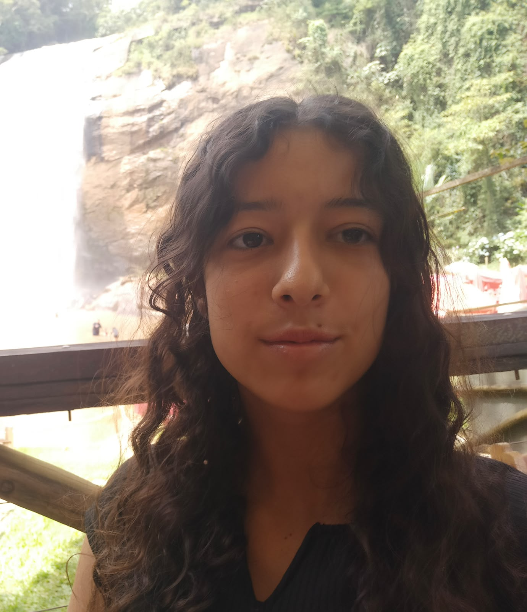

# Letícia Furtado

Meu nome é Letícia Furtado e tenho 20 anos. O que me trouxe ao curso de Análise e Desenvolvimento de Sistemas da FATEC São José dos Campos foi meu interesse por lógica e tecnologia, além do incentivo de conhecidos que trabalham na área.

Ainda não possuo experiência profissional na área, mas, graças à metodologia de Aprendizagem por Projetos Integrados, tive contato com empresas parceiras reais ao longo do curso e atuei tanto como desenvolvedora quanto como Product Owner em projetos Scrum.

 

## Contatos

* [GitHub](https://github.com/LeticiaG24)
* [LinkedIn](https://www.linkedin.com/in/let%C3%ADcia-furtado-053b6033a/)
* [E-mail](mailto:leticia24062006@gmail.com)

## Meus Principais Conhecimentos

Gosto de unir o planejamento de produto ao desenvolvimento, atuando tanto no back-end quanto no front-end. Entre todos os meus conhecimentos, se destacam:

* Python
* Java
* JavaScript
* TypeScript
* React
* Docker
* HTML
* CSS
* Node.js

## Meus Projetos

|Projeto|Período|Solução Desenvolvida|
|---|---|---|
|[Primeiro Semestre – SIRAAS](/projetos/1-semestre.md)|2025-1|Sistema web para registro e gerenciamento de atestados médicos, acompanhamento de afastamentos e avaliação de equipes Scrum pelo método PACER.|
|[Segundo Semestre – Sphera](/projetos/2-semestre.md)|2025-2|Plataforma de gestão e acompanhamento de Planos de Desenvolvimento Individual (PDIs), com relatórios e indicadores para apoiar decisões estratégicas de gestores e RH.|
|[Terceiro Semestre – DM Insight](/projetos/3-semestre.md)|2026-1|Plataforma de análise de dados do Banco Central para identificar regiões com baixo risco de inadimplência e potencial de expansão de crédito, por meio de gráficos e rankings.|
|[Quarto Semestre – PRO4TECH](/projetos/4-semestre.md)|2026-2|Aplicação com base de conhecimento e Inteligência Artificial para auxiliar Product Owners na análise e elaboração de projetos e backlogs, identificando inconsistências, oportunidades de melhoria e relações com projetos anteriores.|